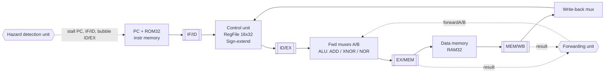
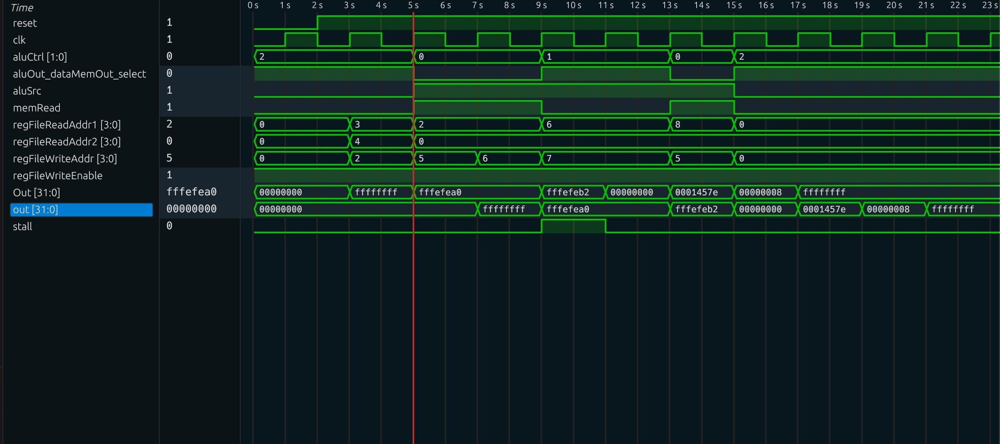

# 5-Stage Pipelined RISC Processor (MIPS-style) in Verilog

A 5-stage (IF / ID / EX / MEM / WB) pipelined processor with a **hazard detection unit (load-use stall)** and a **forwarding unit**, written in Verilog and simulated using Vivado and Icarus Verilog.

**Portfolio author:** Havish Kadaveru · [havish.kadaveru@gmail.com](mailto:havish.kadaveru@gmail.com)

**Demonstrates:** processor architecture, instruction execution, datapath design, pipelining, control logic, hazard handling.

> **Context:** Course project for *CS F342 Computer Architecture* (Group 42). This repository presents the processor RTL and verification artefacts from that project.
> **My contribution:** Worked on the processor implementation and verification tasks represented here, including datapath integration, control logic, register-file integration, forwarding, load-use hazard detection, and testbench validation.
>
> The ISA is a small custom MIPS-style subset (3 instructions, 16 registers), not binary-compatible with MIPS.

## Architecture



### Instruction set

Format: `[31:28] opcode | [27:24] dest | [23:20] rs | [19:16] rt | [15:0] immediate`

| Instruction | Opcode | ALU op | Operation |
|---|---|---|---|
| `NOR rd, rs, rt` | `0000` | NOR | `rd = ~(rs \| rt)` |
| `LW rd, imm(rs)` | `0100` | ADD | `rd = Mem[rs + sext(imm)]` |
| `XNORI rd, rs, imm` | `0010` | XNOR | `rd = ~(rs ^ sext(imm))` |

Anything else decodes as a NOP. Register `r0` is never written.

### Pipeline registers

| Register | Width | Contents |
|---|---|---|
| IF/ID | 32 | instruction |
| ID/EX | 114 | data1, data2, immediate (3x32), rs, rt, dest (3x4), ALUCtrl (2), ALUSrc, RegWrite, MemRead, WBSelect |
| EX/MEM | 39 | ALU result (32), dest (4), RegWrite, MemRead, WBSelect |
| MEM/WB | 70 | mem data (32), ALU result (32), dest (4), RegWrite, WBSelect |

## Hazard handling

- **Forwarding unit (`fu.v`)** gives priority to EX/MEM over MEM/WB. It selects `10` (EX/MEM), `01` (MEM/WB) or `00` (register file) for each ALU input, and ignores `r0`.
- **Hazard detection unit (`hdu.v`)** detects a load-use dependency (`idex_memRead` and the load destination matches `rs`/`rt` in ID). It freezes the PC and IF/ID for one cycle and inserts a bubble into ID/EX.

## Test program and results

Registers are initialised to `r3 = 0x10101`, `r4 = 0x1015F`, `r8 = 0x8`.

| # | Instruction | Hazard | Handling | Result |
|---|---|---|---|---|
| 1 | `NOR r2, r3, r4` | none | n/a | `r2 = 0xFFFEFEA0` |
| 2 | `LW r5, 0(r2)` | RAW on r2 (distance 1) | EX/MEM -> EX forward | `r5 = 0xFFFEFEA0` |
| 3 | `LW r6, 0x12(r2)` | RAW on r2 (distance 2) | MEM/WB -> EX forward | `r6 = 0xFFFEFEB2` |
| 4 | `XNORI r7, r6, 0x4433` | **load-use** on r6 | 1-cycle stall + MEM/WB forward | `r7 = 0x0001457E` |
| 5 | `LW r5, 0(r8)` | none | n/a | `r5 = 0x00000008` |

Self-checking testbench output (`tb/Proctb_check.v`, Icarus Verilog 12.0, log in `sim/check_log.txt`):

```
PASS  r2 = 0xfffefea0
PASS  r5 = 0x00000008
PASS  r6 = 0xfffefeb2
PASS  r7 = 0x0001457e
Load-use stall cycles       : 1 (expected 1)
EX/MEM -> EX forwards (A)   : 1
MEM/WB -> EX forwards (A)   : 2
RESULT: ALL CHECKS PASSED
```

### Vivado waveform



The `stall` pulse is visible while `XNORI` waits on the `LW` to `r6`. The ALU output `0001457e` is the XNORI result, followed by `00000008` for the final `LW`.

## Run the simulation

```bash
./sim/run.sh                  # self-checking test + generates build/Proctb.vcd
# Open build/Proctb.vcd with a VCD waveform viewer if desired
```

Manual: `iverilog -g2012 -o sim rtl/*.v tb/Proctb_check.v && vvp sim`

## Repository layout

`rtl/`: `Proc.v` (top), `cu.v`, `regfile32.v`, `fu.v`, `hdu.v`, `alu32.v`, `ROM32.v`, `RAM32.v`, `add32.v`, mux and sign-extender modules. `tb/`: `Proctb.v` (waveform), `Proctb_check.v` (self-checking). `docs/`: Vivado waveform evidence. The original group report is not redistributed in this public portfolio copy.

## Limitations / future work

- **Data memory is a stub:** `RAM32` returns the address as read data, so a load's result equals its effective address. Real load/store data is not modelled.
- **Missing write-through in the register file:** a register read in ID in the same cycle its value is written back gets the stale value. The test program never has a dependency at distance 3, so it does not trigger this. Testing a producer followed by two independent instructions and then a consumer showed the consumer reading 0. Fix: bypass `writeData` to the read ports when the addresses match.
- Only 3 instructions: no stores, branches or jumps, so no control hazards or branch prediction.
- `Proc.v` generates its own clock, so it is a simulation top rather than a synthesisable one.
- Planned: SW/BEQ, branch handling, a real data memory, and a RISC-V version.
