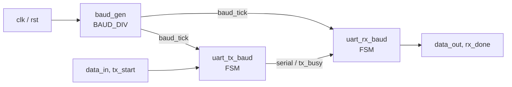
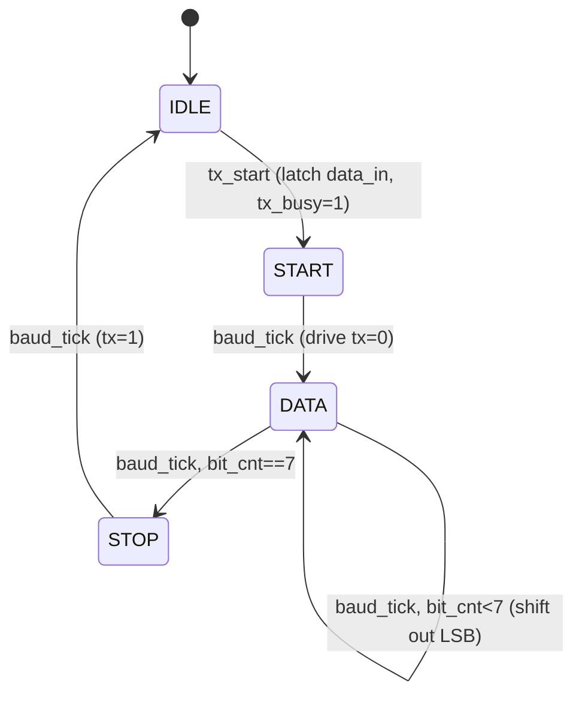
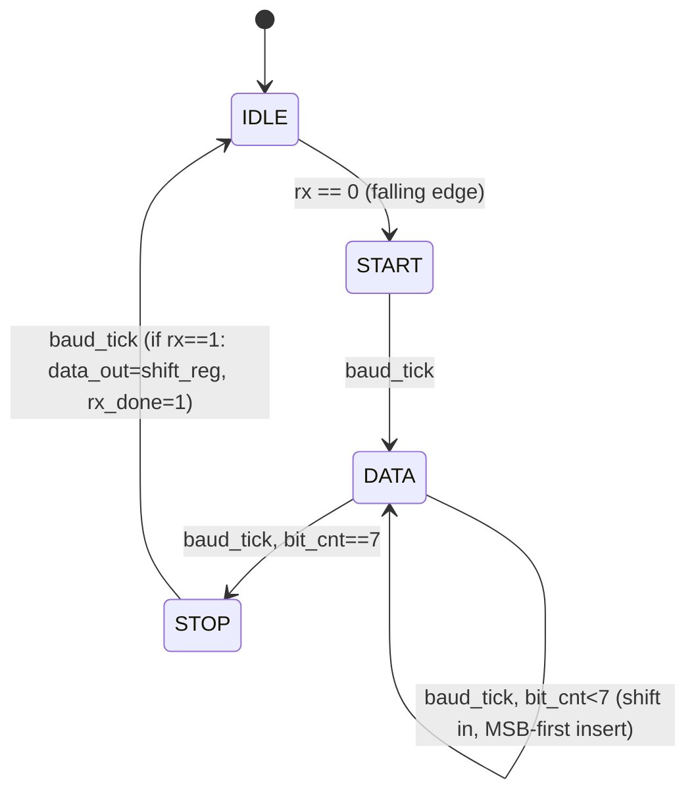
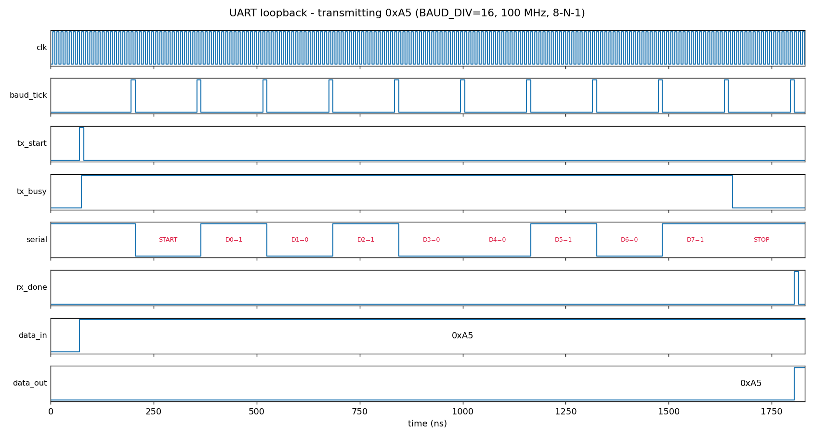

# UART Design (Verilog)

A parameterised UART transmitter and receiver (8-N-1) driven by a shared baud-rate generator, verified in loopback with an FSM-state-logging testbench.

**Author:** Havish Kadaveru · [havish.kadaveru@gmail.com](mailto:havish.kadaveru@gmail.com)

**Demonstrates:** RTL development, serial communication, baud rate control, FSM-based design, TX/RX implementation, testbench-based verification.

## Architecture



| Module | File | Role |
|---|---|---|
| `baud_gen` | `rtl/baud_gen.v` | Counter that emits a one-clock `baud_tick` every `BAUD_DIV` clocks. |
| `uart_tx_baud` | `rtl/uart_tx.v` | 4-state transmit FSM + 8-bit shift register. |
| `uart_rx_baud` | `rtl/uart_rx.v` | 4-state receive FSM + 8-bit shift register, with stop-bit check. |
| `uart_loopback_top` | `rtl/uart_loopback_top.v` | Wires TX output to RX input for self-test. |

## Implementation

**Frame format:** 1 start bit (0), 8 data bits (LSB first), 1 stop bit (1), no parity. One frame = 10 baud ticks.

**Baud rate:** `baud = f_clk / BAUD_DIV`. For example, `BAUD_DIV = 868` at 100 MHz gives about 115,200 baud. The testbench uses `BAUD_DIV = 16` to keep simulations short.

**TX FSM** (`IDLE → START → DATA → STOP → IDLE`)



**RX FSM**



`rx_done` is only asserted when the stop bit is valid (`rx == 1`), so a corrupted frame is silently discarded.

## Verification & Results

Testbench: `tb/tb_uart_loopback_states.sv` sends 5 bytes through the loopback and compares received data to sent data. It also logs every FSM transition per baud tick, monitors the serial line, and has a watchdog timeout.

| Sent | Received | Result |
|---|---|---|
| 0xA5 | 0xA5 | PASS |
| 0xFF | 0xFF | PASS |
| 0x00 | 0x00 | PASS |
| 0x55 | 0x55 | PASS |
| 0x3C | 0x3C | PASS |

**Simulator output:** `5 PASS  0 FAIL` (Icarus Verilog 12.0). Full log: [`sim/uart_sim_log.txt`](sim/uart_sim_log.txt).



The waveform shows the frame for `0xA5` (`1010_0101`): start bit, then D0..D7 = 1,0,1,0,0,1,0,1 (LSB first), then stop bit, with `rx_done` pulsing and `data_out = 0xA5` at the end.

## Run the Simulation

```bash
# from this folder
./sim/run.sh                    # compiles, runs, writes sim/uart_sim_log.txt and sim/out/uart_states.vcd
# Open sim/out/uart_states.vcd with a VCD waveform viewer if desired
python3 sim/plot_waveform.py    # regenerate docs/waveform_0xA5.png (needs matplotlib)
```

Manual: `iverilog -g2012 -o uart_sim rtl/*.v tb/tb_uart_loopback_states.sv && vvp uart_sim`

## Limitations / Future Work
- RX and TX share one `baud_tick`, which is why the loopback works without oversampling. A standalone RX connected to an external device needs 16x oversampling with mid-bit sampling and start-bit re-synchronisation.
- No parity, framing-error or overrun flags.
- No TX/RX FIFOs; `tx_start` is ignored while `tx_busy` is high.
- Planned: 16x oversampling RX, parity option, FIFOs, and an FPGA demo.
