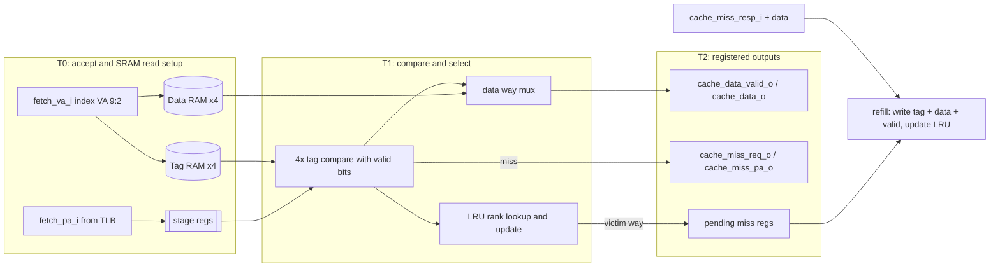
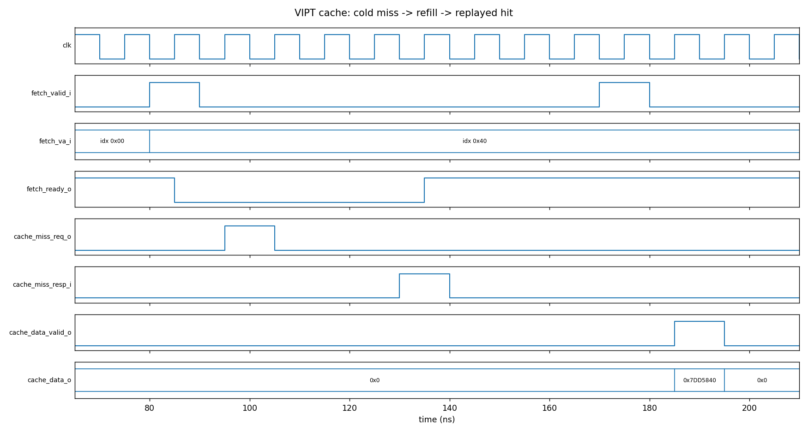
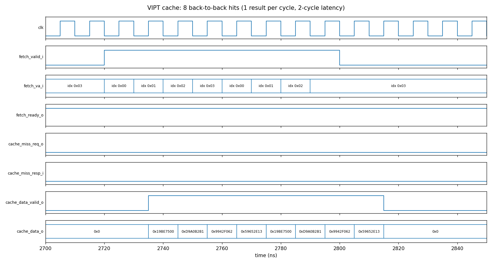

# VIPT Cache: 4 KB, 4-Way, 3-Stage Pipelined (Verilog)

A Virtually Indexed, Physically Tagged (VIPT) L1 cache with true-LRU replacement, built around 1RW1R SRAM arrays, with a self-checking testbench.

**Author:** Havish Kadaveru · [havish.kadaveru@gmail.com](mailto:havish.kadaveru@gmail.com)

**Demonstrates:** cache organisation, virtual/physical address handling, cache indexing, memory hierarchy, pipelined RTL, replacement policy design.

> **Specification source:** the parameters (4 KB, 4 ways, 4-byte lines, 4 KB pages, `sky130_sram_1kbyte_1rw1r_32x256_8`, 3-stage pipeline, LRU) come from a published project idea by Rahul Behl (Tenstorrent). The microarchitecture, RTL and testbench in this repo are my own implementation of that spec.

## Parameters and address breakdown

| Item | Value |
|---|---|
| Capacity / line size / ways | 4 KB / 4 B / 4 |
| Sets | 256 (= 4 KB / (4 ways x 4 B)) |
| Page size | 4 KB |
| Index | `VA[9:2]` (8 bits) |
| Byte offset | `VA[1:0]` |
| Tag | `PA[44:12]` (33 bits, parameterised via `PA_W`) |
| Replacement | true LRU (2-bit rank per way per set) |

**Why VIPT works here:** the page offset is `VA[11:0] = PA[11:0]`. Index and offset use only bits `[9:0]`, which lie inside the page offset, so the SRAM read can start with the *virtual* index while the TLB translates the page number in parallel. The tag compare then uses the *physical* tag. Because the index never uses translated bits, there are no synonym/aliasing problems.

```
 VA / PA :  [44 ............ 12] [11 .. 10] [9 ....... 2] [1 .. 0]
            |<--- PA tag (TLB) ->| (page offset, same in VA and PA) |
                                    unused    index (VA)    byte offset
```

## Microarchitecture



| Stage | What happens |
|---|---|
| **T0** | Fetch accepted. All 4 tag and 4 data SRAMs start a read with the virtual index. VA offset bits and the physical tag are registered. |
| **T1** | SRAM outputs arrive. Four comparators check `valid && stored_tag == PA_tag`. The hit way selects the data. The LRU ranks for the set are read; on a hit the hit way becomes MRU. On a miss the victim is chosen: first invalid way, otherwise the LRU way. |
| **T2** | Output registers drive `cache_data_valid_o`/`cache_data_o` on a hit, or `cache_miss_req_o`/`cache_miss_pa_o` on a miss. |

**Hit latency:** 2 cycles after accept. **Throughput:** one fetch per cycle for hits.

**Miss handling:** one outstanding miss. `fetch_ready_o` drops while a miss is pending. On `cache_miss_resp_i` the line is written into the victim way (tag RAM, data RAM, valid bit), the LRU is updated, and the requester replays the access, which then hits.

### Files

| File | Role |
|---|---|
| `rtl/vipt_cache.v` | Top level: pipeline, tag compare, data mux, refill, valid bits |
| `rtl/lru_4way.v` | True-LRU rank storage and update logic |
| `rtl/sram_1rw1r_model.v` | Behavioural 1RW1R SRAM model (same port structure as the SKY130 macro) |
| `tb/tb_vipt_cache.v` | Self-checking testbench with scoreboard and backing-memory model |
| `sim/` | `run.sh`, `plot_waveform.py`, simulation log |

## Verification and results

The testbench's backing memory returns a known function of the physical address, and a scoreboard checks every returned word. Tests:

1. Cold miss, refill, replayed hit.
2. Four different physical tags in **one set** (same virtual index) are all held at once and all hit.
3. **LRU eviction:** after filling A,B,C,D and touching A, a new tag E evicts B (the LRU line) while A, C, D, E stay resident. Reloading B then evicts A, which had become the LRU.
4. A different index with the same tag is independent.
5. Eight back-to-back hits to resident lines return one result per cycle with no stalls.

Result (Icarus Verilog 12.0, log in `sim/vipt_sim_log.txt`):

```
Summary: 29 hits, 13 misses, 35 checks, 0 errors
RESULT: ALL TESTS PASSED
```

**Cold miss -> refill -> replayed hit:**


**Back-to-back hits (1 result per cycle, 2-cycle latency):**


## Run

```bash
./sim/run.sh                         # builds, simulates, writes sim/vipt_sim_log.txt
# Open sim/out/vipt_cache.vcd with a VCD waveform viewer if desired
python3 sim/plot_waveform.py         # regenerate docs/*.png (needs matplotlib)
```

## Design notes and limitations

- **SRAMs are behavioural models**, not the real SKY130 macro; the OpenRAM macro cannot be simulated here. The port structure matches (port 0 write, port 1 read, active-low `csb`/`web`), so the data arrays can be swapped for the macro.
- **Tag width vs SRAM word:** the tag is 33 bits (`PA[44:12]`) but the macro word is 32 bits. The tag model is therefore parameterised to 33 bits. With the real macro, options are a 44-bit physical address (32-bit tag), or a second small array for the extra bit. Valid bits are kept in flops (256 x 4) and are not part of the tag word.
- Read-only (instruction-style) cache: no write path, write policy or coherence.
- One outstanding miss; no miss under hit and no line-fill buffer. Fetches are refused while a miss is pending and are replayed by the requester.
- LRU ranks are stored in flops (256 x 8 bits); a pseudo-LRU (3 bits per set) would be cheaper.
- The TLB is not modelled: the testbench supplies the physical tag together with the virtual address, and constructs PA as `{tag, VA[11:0]}`.
- Not synthesised or taken through OpenLane; timing and area are not evaluated.
